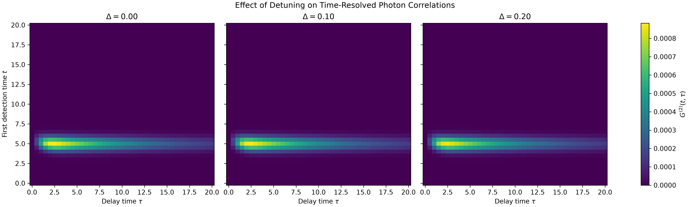
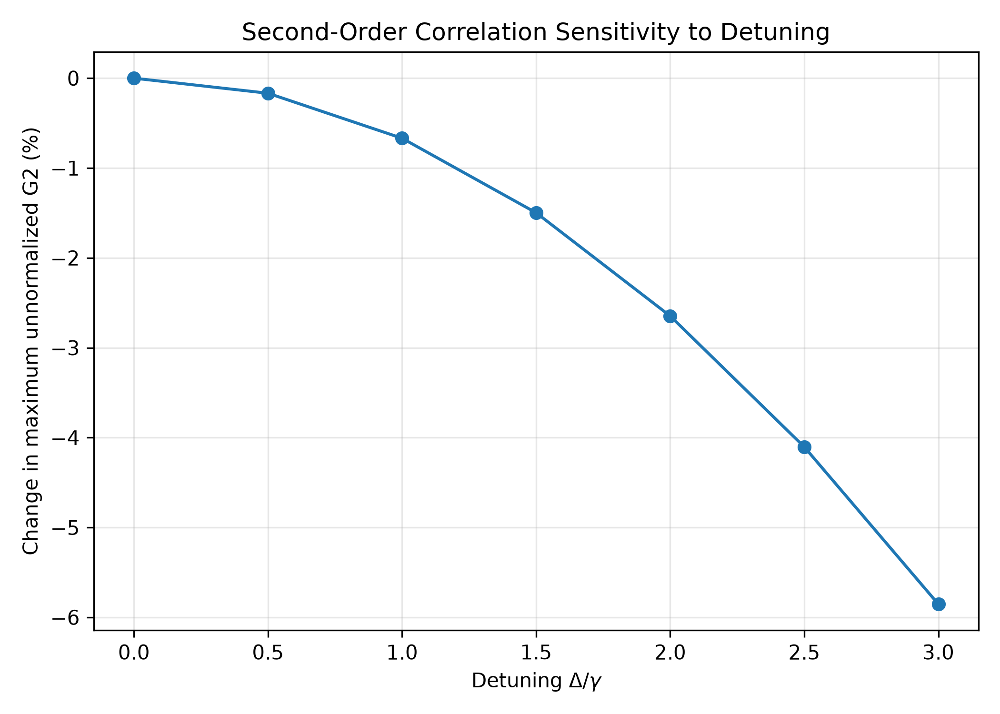
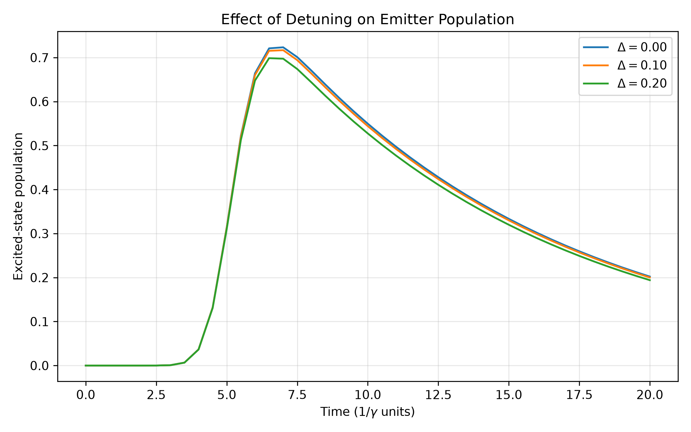
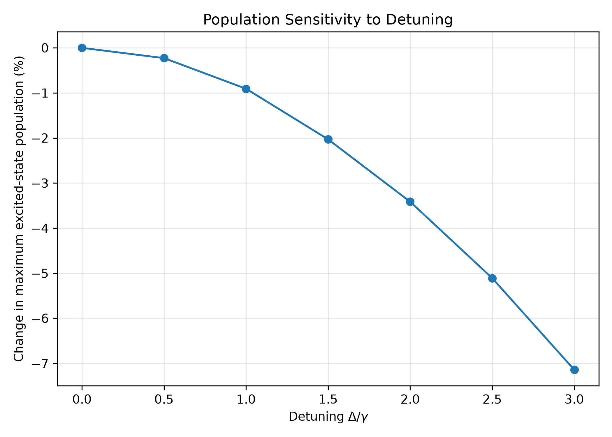
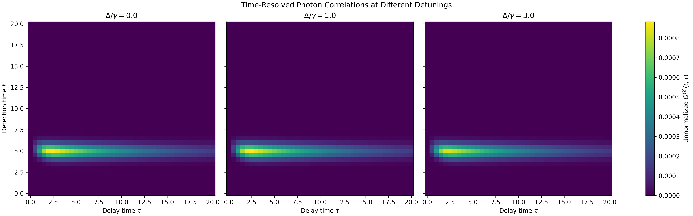
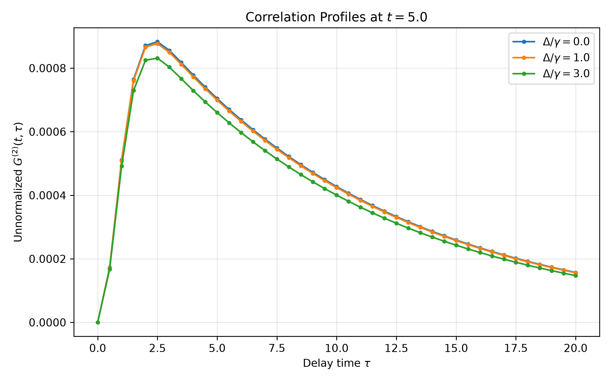
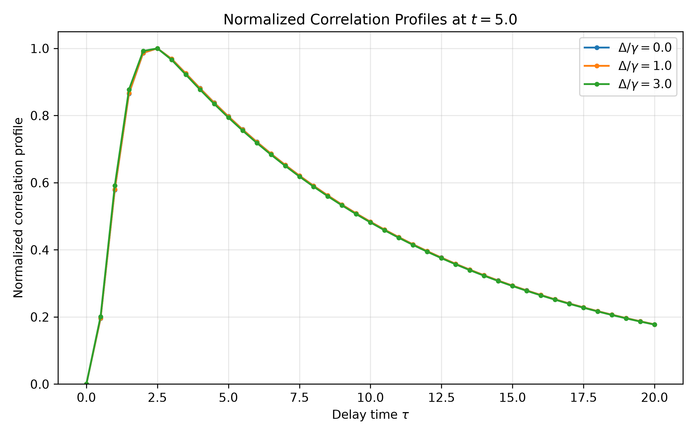
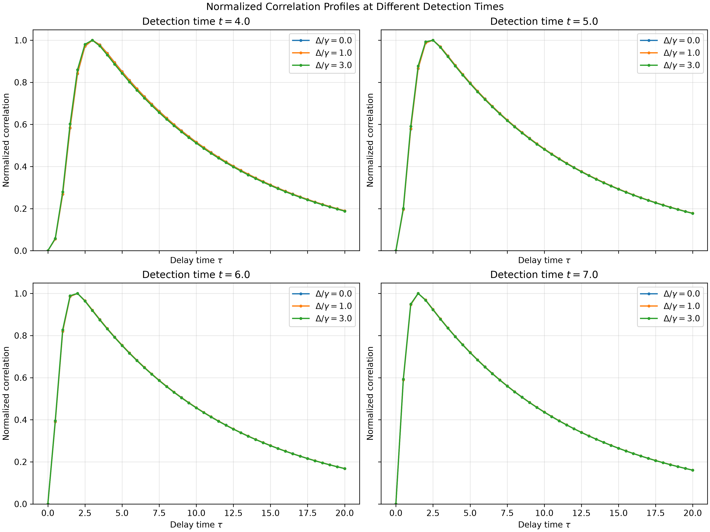
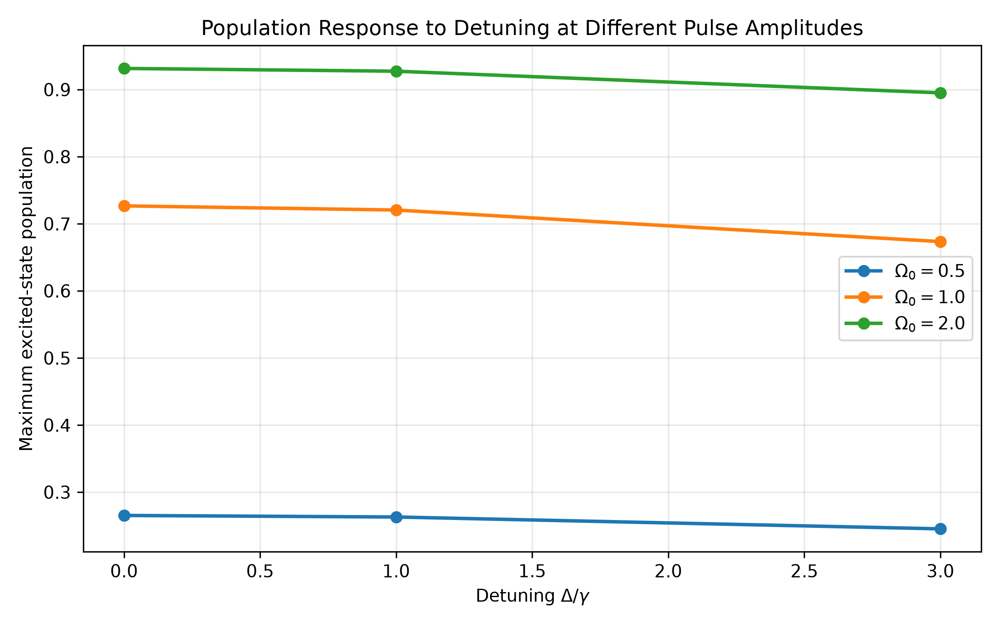
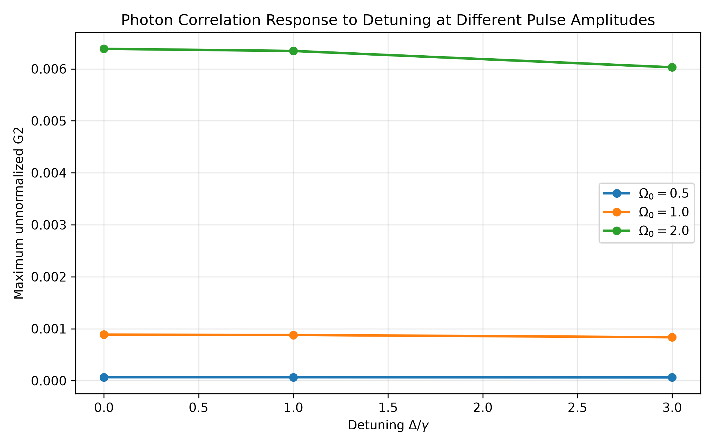

# Time-Resolved Photon Correlations in Driven Quantum Systems

A numerical study of the time-dependent dynamics and second-order photon correlations of a coherently driven two-level quantum emitter.

This project investigates how pulse duration, pulse area, and laser detuning affect the emitter population, photon emission, and time-resolved second-order correlation function. The system is modeled using the Lindblad master equation and simulated with Python and QuTiP.

---

## 1. Project Overview

The interaction of a coherent optical pulse with a two-level quantum emitter provides a fundamental framework for studying quantum optical dynamics and photon statistics.

This project implements a time-dependent numerical model to investigate:

- Excited-state population dynamics under pulsed excitation.
- Time-dependent photon emission intensity.
- Two-time, second-order photon correlations.
- The influence of pulse duration and pulse area.
- The dependence of the dynamics and correlations on laser detuning.
- Numerical stability and convergence of the calculated observables.

The central quantity is the time-resolved second-order correlation function:

$$G^{(2)}(t,\tau) = \gamma^2 \left\langle \sigma_+(t)\,\sigma_+(t+\tau)\,\sigma_-(t+\tau)\,\sigma_-(t) \right\rangle$$

The calculations are performed for a driven two-level system using a time-dependent Hamiltonian and Markovian dissipation.

## 2. Theoretical Model

### 2.1 Two-Level Quantum Emitter

The emitter is represented by two states:

$$|g\rangle = \begin{pmatrix} 1 \\ 0 \end{pmatrix}, \qquad |e\rangle = \begin{pmatrix} 0 \\ 1 \end{pmatrix}$$

The lowering and raising operators are defined as:

$$\sigma_- = |g\rangle\langle e|, \qquad \sigma_+ = |e\rangle\langle g|$$

The excited-state population is:

$$P_e(t) = \langle e|\rho(t)|e\rangle$$

where $`\rho(t)`$ is the density matrix of the emitter.

### 2.2 Gaussian Pulse Excitation

The system is driven by a Gaussian pulse:

$$\Omega(t) = \Omega_0 \exp\left[ -\frac{(t-t_0)^2}{2\sigma^2} \right]$$

where:

- $`\Omega_0`$ is the peak Rabi frequency.
- $`t_0`$ is the pulse center.
- $`\sigma`$ determines the pulse duration.

The pulse area is defined by:

$$A = \int_{-\infty}^{+\infty} \Omega(t)\,dt$$

For the Gaussian pulse:

$$A = \sqrt{2\pi}\,\Omega_0\,\sigma$$

Therefore, at constant pulse area:

$$\Omega_0 = \frac{A}{\sqrt{2\pi}\,\sigma}$$

This relation is used to distinguish the effects of changing pulse duration from those of changing pulse amplitude.

### 2.3 Time-Dependent Hamiltonian

In the rotating frame, the Hamiltonian is:

$$H(t) = \Delta\,|e\rangle\langle e| + \frac{\Omega(t)}{2}\left(\sigma_+ + \sigma_-\right)$$

where $`\Delta`$ is the laser-emitter detuning.

For resonant excitation:

$$\Delta = 0$$

### 2.4 Lindblad Master Equation

The time evolution of the density matrix is described by:

$$\frac{d\rho}{dt} = -i\left[H(t),\rho\right] + \sum_j \left( L_j \rho L_j^\dagger - \frac{1}{2}\left\lbrace L_j^\dagger L_j, \rho \right\rbrace \right)$$

The radiative decay operator is:

$$L_1 = \sqrt{\gamma}\,\sigma_-$$

where $`\gamma`$ is the spontaneous emission rate.

When pure dephasing is included, its contribution is represented by:

$$L_2 = \sqrt{\frac{\gamma_\phi}{2}}\,\sigma_z$$

where $`\gamma_\phi`$ is the pure-dephasing rate.

The simulations use the QuTiP master-equation solver to calculate the system dynamics.

### 2.5 Photon Emission Intensity

The instantaneous photon emission intensity is proportional to:

$$I(t) = \gamma \langle \sigma_+\sigma_- \rangle$$

Equivalently:

$$I(t) = \gamma P_e(t)$$

This observable describes the time-dependent emission probability density up to the chosen detection-rate convention.

### 2.6 Second-Order Photon Correlations

The time-resolved second-order correlation function is calculated as:

$$G^{(2)}(t,\tau) = \gamma^2 \left\langle \sigma_+(t)\,\sigma_+(t+\tau)\,\sigma_-(t+\tau)\,\sigma_-(t) \right\rangle$$

Using the quantum regression approach, the calculation involves the conditional density operator following the first photon-detection event.

The corresponding unnormalized conditional state is initialized as:

$$\rho_c(t) = \sigma_-\,\rho(t)\,\sigma_+$$

and subsequently evolved from $`t`$ to $`t+\tau`$.

The correlation function is then obtained from the conditional excited-state population:

$$G^{(2)}(t,\tau) = \gamma^2 \, \mathrm{Tr}\left[ \sigma_+\sigma_-\,\rho_c(t+\tau) \right]$$

The unnormalized correlation function is retained throughout the analysis. It should not be confused with the normalized correlation function $`g^{(2)}`$.

---

## 3. Numerical Implementation

The project is organized into three main source modules.

| Module | Description |
|---|---|
| `src/model.py` | Defines the quantum states, operators, Hamiltonian, and physical parameters. |
| `src/dynamics.py` | Calculates the time evolution of the density matrix and excited-state population. |
| `src/correlations.py` | Calculates the time-resolved second-order photon correlation function. |

The simulation scripts are located in the `simulations/` directory. Generated figures are saved in `figures/`.

### Main Numerical Parameters

The baseline model uses the following parameter configuration:

| Parameter | Symbol | Value |
|---|:---:|:---:|
| Radiative decay rate | $`\gamma`$ | 1.0 |
| Pure-dephasing rate | $`\gamma_\phi`$ | 0 |
| Detuning | $`\Delta`$ | 0 |
| Peak Rabi frequency | $`\Omega_0`$ | 1.0 |
| Pulse center | $`t_0`$ | 5.0 |
| Pulse width | $`\sigma`$ | 1.0 |
| Detection-time interval | $`t`$ | 0–20 |
| Delay interval | $`\tau`$ | 0–20 |

The numerical time grids and solver tolerances are specified in the corresponding simulation scripts.

---

## 4. Simulation Results

### 4.1 Excited-State Population Dynamics

The first simulation examines the time evolution of the excited-state population under Gaussian pulse excitation.

The population increases during the interaction with the pulse and subsequently evolves under the influence of coherent dynamics and spontaneous emission.


### 4.2 Photon Emission Intensity

The emission intensity follows the excited-state population through the radiative decay relation:

$$I(t) = \gamma P_e(t)$$

The resulting temporal profile provides information about the emission dynamics following pulsed excitation.


### 4.3 Time-Resolved Second-Order Correlations

The two-time correlation function describes the dependence of photon correlations on the detection time $`t`$ and the time delay $`\tau`$.

The calculated correlation map provides a representation of the temporal structure of the emitted photon statistics.


For an ideal two-level emitter, the zero-delay correlation vanishes:

$$G^{(2)}(t,0) = 0$$

This behavior reflects the inability of an ideal two-level emitter to emit two photons simultaneously.

### 4.4 Pulse-Duration Dependence

The pulse duration affects the temporal excitation profile and the subsequent photon-correlation dynamics.

Two complementary comparisons are considered:

1. Changing pulse duration while keeping the peak Rabi frequency fixed.
2. Changing pulse duration while keeping the pulse area fixed.

The distinction is important because changing $`\sigma`$ at fixed $`\Omega_0`$ also changes the pulse area.

#### Fixed Peak Rabi Frequency

The following figure compares the dynamics for different pulse durations while maintaining the peak Rabi frequency.


The corresponding second-order correlation functions are compared below.


#### Fixed Pulse Area

For a constant pulse area, the peak Rabi frequency is adjusted according to:

$$\Omega_0 = \frac{A}{\sqrt{2\pi}\,\sigma}$$

This comparison isolates the influence of pulse duration under a fixed integrated driving strength.


The numerical results for the pulse-duration comparison are summarized below.

| Pulse width $`\sigma`$ | Maximum $`G^{(2)}`$ | Delay at maximum |
|:---:|:---:|:---:|
| 0.5 | $`3.17\times10^{-5}`$ | 1.5 |
| 1.0 | $`2.78\times10^{-5}`$ | 2.5 |
| 2.0 | $`2.13\times10^{-5}`$ | 4.0 |

These values describe the investigated numerical parameter set and should not be interpreted as universal properties of two-level emitters.

### 4.5 Weak-Excitation Scaling

In the weak-excitation regime, the excited-state population approximately follows a quadratic dependence on the pulse area:

$$P_e^{\max} \propto A^2$$

The second-order correlation amplitude exhibits a stronger dependence:

$$G^{(2)}_{\max} \propto A^4$$

These relations provide useful consistency checks for the weak-driving regime.

### 4.6 Detuning Dependence

The effect of laser-emitter detuning is investigated by varying the detuning relative to the radiative decay rate, $`\Delta/\gamma`$.

The simulations compare the excited-state population and the second-order photon correlations for different detuning values.

#### Detuning and Second-Order Correlations



The correlation amplitude is also examined over a wider detuning range.



#### Detuning and Excited-State Population



The population response over the detuning sweep is shown below.



For the investigated parameter range, the relative reductions at $`\Delta/\gamma=3`$ are approximately:

| Observable | Relative reduction |
|---|:---:|
| Maximum excited-state population | 7.14% |
| Maximum second-order correlation | 5.85% |

These percentages refer to the specific baseline and detuning comparison used in the simulations.

### 4.7 Detuning-Dependent Correlation Structure

In addition to the maximum correlation amplitude, detuning can affect the temporal structure of the correlation function.

The following maps compare the correlation distribution across detection times and delays.



The delay-dependent correlation profiles provide a complementary view of the temporal response.



A normalized representation of the profiles is also examined to compare their shapes independently of their overall amplitudes.



This normalized profile comparison is a shape-analysis procedure and is not the same as calculating the conventional normalized $`g^{(2)}`$ function.

### 4.8 Detection-Time Dependence

The correlation function depends on both the first detection time and the subsequent delay.

The following analysis examines how the correlation structure changes with the initial detection time.



### 4.9 Pulse Amplitude and Detuning

The final comparison investigates the combined influence of driving strength and detuning on the excited-state population and second-order photon correlations.

#### Excited-State Population



#### Second-Order Correlations



These calculations provide a broader view of the interplay between coherent excitation and detuning-dependent emission dynamics.

---

## 5. Numerical Validation

Numerical reliability is essential when evaluating time-dependent quantum correlations.

The project includes several validation procedures.

### 5.1 Solver-Tolerance Comparison

The simulations are repeated using different numerical solver tolerances to evaluate the stability of the calculated observables.

The comparison includes:

- Default solver tolerances.
- Tighter solver tolerances.
- Strict solver tolerances.

The observed maximum differences in the tested calculations are approximately:

| Quantity | Maximum difference |
|---|:---:|
| Absolute difference in $`G^{(2)}`$ | $`2.39\times10^{-9}`$ |
| Relative difference in $`G^{(2)}`$ | $`8.6\times10^{-5}`$ |
| Population difference | $`2.9\times10^{-7}`$ |

These values characterize the tested numerical configurations.

### 5.2 Time-Grid Refinement

The effect of time-grid resolution is examined by comparing calculations using progressively finer grids.

The tested grid sizes include $`N = 41, 81, 161, 321`$.

For the comparison between the 161-point and 321-point grids, the maximum relative differences in the sampled maxima are approximately:

| Observable | Maximum relative difference |
|---|:---:|
| Excited-state population | 0.26714% |
| Second-order correlation | 0.02261% |

The results indicate numerical stability for the investigated observables and parameter ranges.

### 5.3 Physical Consistency Checks

The calculations are also examined for basic physical consistency:

- The density matrix remains normalized.
- The density matrix remains Hermitian.
- The excited-state population remains within the physical interval $`0 \leq P_e(t) \leq 1`$.
- The calculated second-order correlation remains nonnegative within numerical accuracy.
- The zero-delay correlation is consistent with antibunching for an ideal two-level emitter, $`G^{(2)}(t,0)=0`$.

These checks help identify numerical errors and inconsistencies in the simulation.

---

## 6. Repository Structure

```text
time-resolved-photon-correlations/
│
├── figures/
│   ├── detuning_g2_comparison.png
│   ├── detuning_g2_sweep.png
│   ├── detuning_population_comparison.png
│   ├── detuning_population_sweep.png
│   ├── g2_constant_area_comparison.png
│   ├── g2_detuning_maps.png
│   ├── g2_detuning_normalized_profiles.png
│   ├── g2_detuning_profiles.png
│   ├── g2_detuning_time_dependence.png
│   ├── g2_pulse_duration_comparison.png
│   ├── intensity_detuning_g2.png
│   ├── intensity_detuning_population.png
│   ├── photon_intensity.png
│   ├── population_dynamics.png
│   ├── pulse_duration_comparison.png
│   └── time_resolved_g2.png
│
├── simulations/
│   ├── detuning_comparison.py
│   ├── g2_pulse_duration_comparison.py
│   ├── g2_detuning_structure.py
│   ├── g2_detuning_normalized.py
│   ├── g2_detuning_time_dependence.py
│   └── ...
│
├── src/
│   ├── model.py
│   ├── dynamics.py
│   └── correlations.py
│
├── README.md
├── requirements.txt
├── LICENSE
└── .gitignore
```

---

## 7. Installation

Clone the repository:

```bash
git clone https://github.com/mahdiyeh-ghasemi/time-resolved-photon-correlations.git
cd time-resolved-photon-correlations
```

Create and activate a virtual environment:

```bash
python -m venv .venv
```

On Linux or macOS:

```bash
source .venv/bin/activate
```

On Windows:

```bash
.venv\Scripts\activate
```

Install the required dependencies:

```bash
pip install -r requirements.txt
```

---

## 8. Running the Simulations

The simulation scripts can be executed individually from the repository root.

For example:

```bash
python simulations/detuning_comparison.py
```

To run the pulse-duration comparison:

```bash
python simulations/g2_pulse_duration_comparison.py
```

To run the detuning-dependent correlation analysis:

```bash
python simulations/g2_detuning_time_dependence.py
```

Generated figures are stored in the `figures/` directory.

The exact available scripts can be inspected in the `simulations/` directory.

---

## 9. Limitations and Scope

The present implementation focuses on a single two-level quantum emitter under coherent pulsed excitation.

The model uses a Markovian master-equation description and does not explicitly include:

- Multilevel emitter structure.
- Multiple interacting emitters.
- Non-Markovian environmental effects.
- Spatial propagation of the optical field.
- Detector response, timing jitter, or finite detection efficiency.
- Experimental noise and background counts.

The numerical results should therefore be interpreted within the assumptions and parameter ranges of the model.

---

## 10. Technologies

- Python
- NumPy
- SciPy
- QuTiP
- Matplotlib
- Git and GitHub

---

## 11. License

This project is distributed under the MIT License. See the `LICENSE` file for details.

---

## 12. Author

**Mahdiyeh Ghasemi**

Research interests:

- Quantum Optics
- Photon Statistics
- Time-Resolved Photon Correlations
- Quantum Dynamics
- Computational Physics