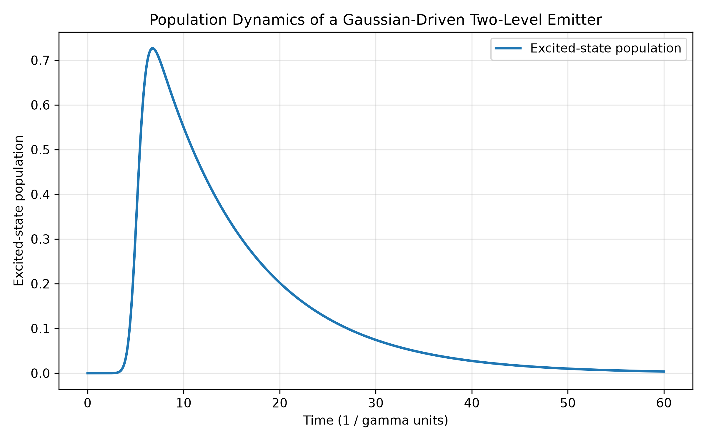
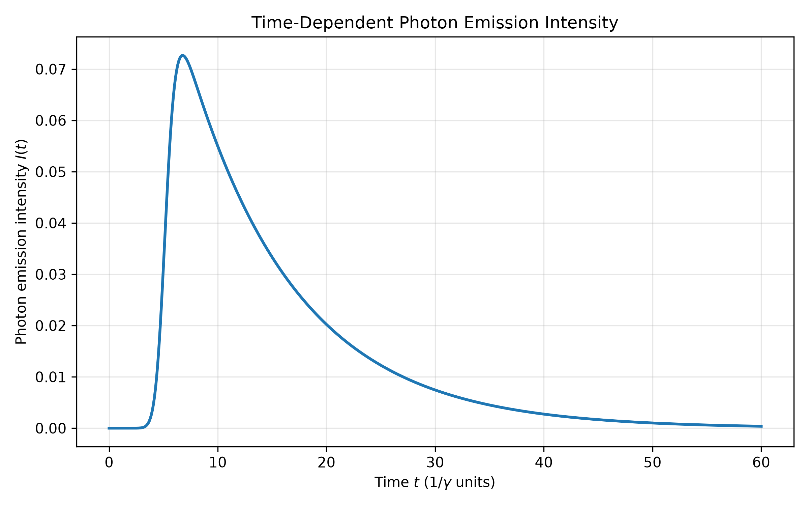
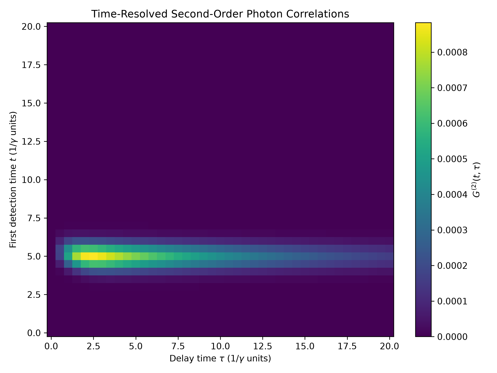
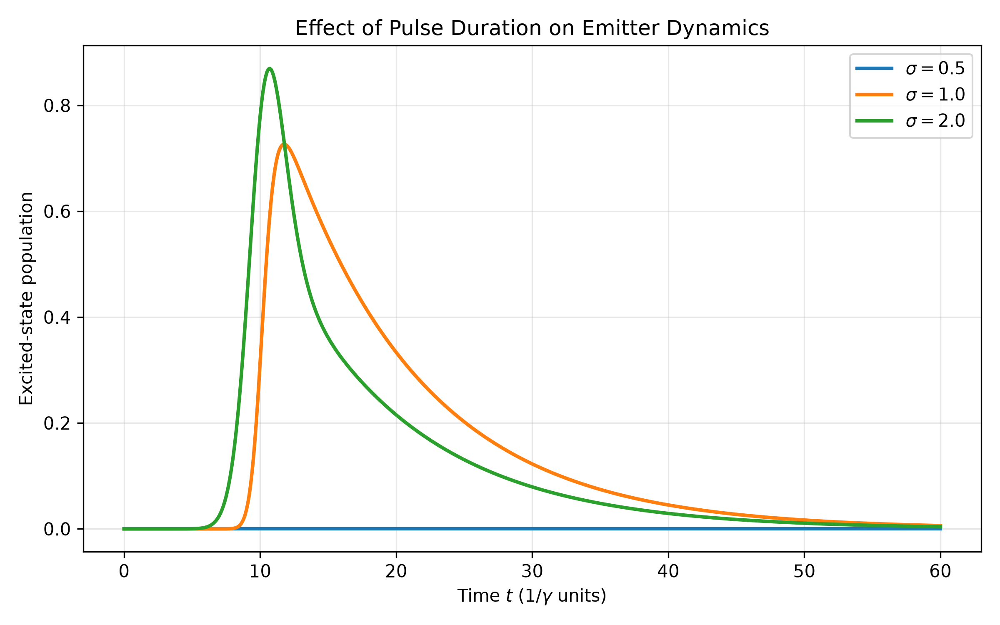
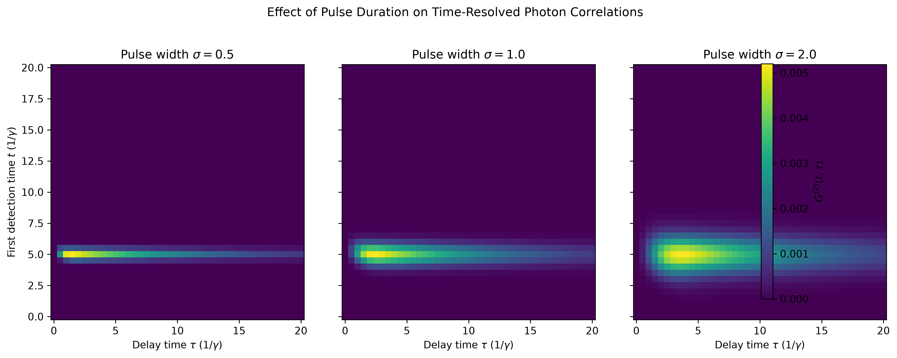
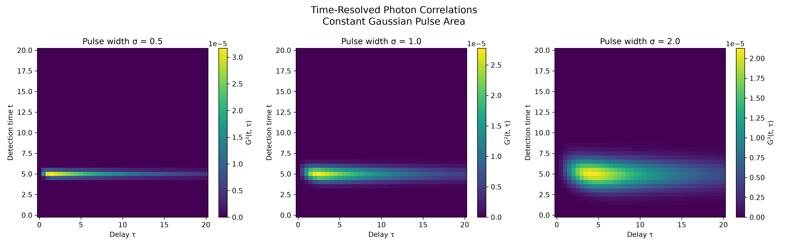

# Time-Resolved Photon Correlations in Driven Quantum Systems

## Project Overview

This project investigates the time-resolved photon correlations emitted by a driven quantum emitter under pulsed excitation.

The initial study will use a driven two-level quantum system as a minimal theoretical model. Its dynamics will be described using the Lindblad master equation, with particular attention to the temporal structure of second-order photon correlations.

## Research Question

How do the pulse duration and excitation strength affect the time-resolved photon correlations emitted by a driven quantum emitter?

## Methodology

- Model a driven two-level quantum emitter.
- Implement time-dependent pulsed excitation.
- Solve the open-system dynamics using the Lindblad master equation.
- Calculate time-resolved first- and second-order photon correlation functions.
- Investigate the effects of pulse duration and excitation strength.

## Scope

The initial stage focuses on a minimal two-level emitter model. More complex systems and additional physical effects may be considered in later extensions.

## Project Status

Research model and computational framework under development.

## Theoretical Model

The system is modeled as a driven two-level quantum emitter with ground state $|g\rangle$ and excited state $|e\rangle$.

In the rotating frame and using $\hbar=1$, the Hamiltonian is

$$
H(t)=\Delta\sigma_+\sigma_-+\frac{\Omega(t)}{2}(\sigma_++\sigma_-).
$$

where the Gaussian driving pulse is

$$
\Omega(t)=\Omega_0\exp\left[-\frac{(t-t_0)^2}{2\sigma^2}\right].
$$

The open-system dynamics are described by the Lindblad master equation:

$$
\dot{\rho}=-i[H(t),\rho]
+\gamma\mathcal{D}[\sigma_-]\rho
+\frac{\gamma_\phi}{2}\mathcal{D}[\sigma_z]\rho.
$$

Here, $\gamma$ describes spontaneous emission, while $\gamma_\phi$ is the pure-dephasing rate.

The Lindblad dissipator is defined as

$$
\mathcal{D}[c]\rho
=c\rho c^\dagger
-\frac{1}{2}\left\{c^\dagger c,\rho\right\}.
$$

## Numerical Validation

The computational implementation was examined through several numerical tests:

- Population dynamics and spontaneous-emission behavior.
- Zero-delay antibunching of the two-level emitter.
- Positivity of the calculated second-order correlation within numerical tolerance.
- Convergence with respect to temporal grid refinement.
- Weak-excitation scaling of population and photon correlations.

For weak excitation, the numerical results are consistent with:

$$
P_e^{\max}\propto A^2,
\qquad
G_{\max}^{(2)}\propto A^4,
$$

where A is the Gaussian pulse area.

## Results

The simulations examine the population dynamics, emission intensity, and time-resolved second-order photon correlations of a driven two-level emitter.

### Population Dynamics

The time evolution of the excited-state population illustrates the emitter's response to the Gaussian driving pulse and its subsequent relaxation through spontaneous emission.

### Photon Emission Intensity

The emission intensity is obtained from the excited-state population and the spontaneous emission rate, illustrating the temporal profile of photon emission.

### Time-Resolved Photon Correlations

The second-order correlation function \(G^{(2)}(t,\tau)\) describes the time-dependent photon-pair emission correlations following pulsed excitation.

### Pulse-Duration Dependence

A comparison was performed for Gaussian driving pulses with different temporal widths while keeping the pulse area constant at \(A=1\). The pulse amplitudes were adjusted according to

$$
\Omega_0 = \frac{A}{\sqrt{2\pi}\sigma}.
$$

For pulse widths \(\sigma = 0.5,\ 1.0,\ 2.0\), the maximum values of the time-resolved correlation function were approximately:

| Pulse width \(\sigma\) | Maximum \(G^{(2)}\) | Peak delay |
|---:|---:|---:|
| 0.5 | \(3.17 \times 10^{-5}\) | 1.5 |
| 1.0 | \(2.78 \times 10^{-5}\) | 2.5 |
| 2.0 | \(2.13 \times 10^{-5}\) | 4.0 |

Within this parameter regime, broader pulses produce a lower peak correlation value and shift the peak toward longer delays. These results illustrate how the temporal profile of the excitation can influence the emission correlations, even when the pulse area is held fixed.

### Generated Figures

| Figure | Description |
|---|---|
| `population_dynamics.png` | Excited-state population dynamics |
| `photon_intensity.png` | Time-dependent emission intensity |
| `time_resolved_g2.png` | Time-resolved second-order photon correlation |
| `pulse_duration_comparison.png` | Population response for different pulse durations |
| `g2_pulse_duration_comparison.png` | Photon correlations for different pulse durations |
| `g2_constant_area_comparison.png` | Correlation comparison at constant pulse area |

All simulations are implemented in Python using QuTiP, NumPy, SciPy, and Matplotlib.
